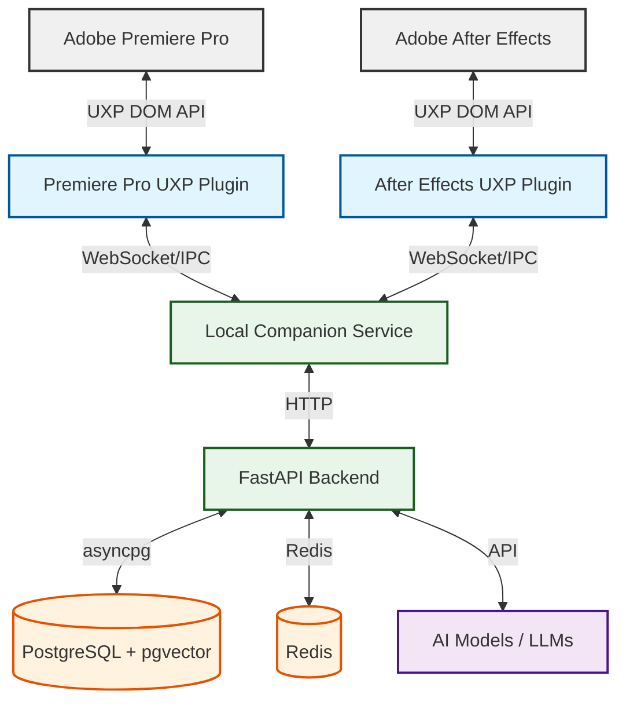

# AAVE Architecture

Autonomous AI Video Editor - System Architecture

Copyright (c) 2026 Randi Sumitro. All rights reserved.
Author: Randi Sumitro (https://github.com/randisumitro)
License: MIT

## Overview

AAVE (Autonomous AI Video Editor) is a plugin-first AI video editing system that operates through Adobe Premiere Pro and Adobe After Effects. The system analyzes video footage, makes creative decisions, executes editing operations, and generates professional short-form videos.

## Component Architecture



## Components

### 1. Premiere Pro UXP Plugin (`apps/premiere-plugin/`)

**Responsibilities:**
- Active project and sequence detection
- Media import and timeline inspection
- Clip arrangement and track management
- Smart cutting and marker creation
- Subtitle and audio placement
- Effect application and export management

**Key Files:**
- `manifest.json` - UXP plugin manifest
- `src/index.js` - Plugin entry point, lifecycle management
- `src/panels/AavePanel.js` - Spectrum UI panel with connection status
- `src/adapters/PremiereAdapter.js` - Premiere Pro DOM API wrapper
- `src/services/CompanionClient.js` - WebSocket client for local companion
- `src/services/BackendClient.js` - HTTP client for FastAPI backend
- `src/commands/CommandRegistry.js` - Typed command registry with validation

### 2. After Effects UXP Plugin (`apps/after-effects-plugin/`)

**Responsibilities:**
- Project inspection and composition creation
- Text animation and kinetic typography
- Shape animation and keyframe generation
- Motion graphics, lower thirds, animated captions
- Visual effects and alpha-channel export

**Key Files:**
- `manifest.json` - UXP plugin manifest
- `src/index.js` - Plugin entry point, lifecycle management
- `src/panels/AaveMotionPanel.js` - Spectrum UI panel with connection status
- `src/adapters/AfterEffectsAdapter.js` - After Effects DOM API wrapper
- `src/services/CompanionClient.js` - WebSocket client for local companion
- `src/services/BackendClient.js` - HTTP client for FastAPI backend
- `src/commands/CommandRegistry.js` - Typed command registry with validation

### 3. Local Companion Service (`apps/local-companion/`)

**Responsibilities:**
- Secure local-only network binding (127.0.0.1:8077)
- Token-based authentication for local clients
- IPC authentication for WebSocket connections
- Health monitoring with FFmpeg detection
- File access allowlist for security
- Job communication and WebSocket progress reporting
- Local asset management and media processing coordination

**Key Files:**
- `main.py` - FastAPI application with all endpoints
- `tests/test_companion.py` - Unit tests
- `tests/test_auth.py` - Authentication and security tests

### 4. FastAPI Backend (`backend/`)

**Responsibilities:**
- REST API for job management (create, status, cancel, list)
- Model registry interface for AI model routing
- Structured JSON logging (no credential logging)
- PostgreSQL connection with asyncpg (in-memory fallback)
- Standard error responses (AAVEErrorResponse)
- Health endpoints

**Key Files:**
- `main.py` - FastAPI application with lifespan management
- `database/connection.py` - Async PostgreSQL connection pool
- `aave_logging.py` - Structured JSON logging
- `model_registry.py` - Model registry and routing
- `schemas/` - Pydantic schemas for jobs, models, errors
- `tests/` - API, contract, and security tests

### 5. Shared Packages (`packages/`)

**`shared-types/`** - TypeScript interfaces shared between plugins and companion:
- Job status values and state machine
- Project settings and creative direction
- Edit Decision List (EDL) types
- Timeline and motion graphics commands
- Companion message and plugin context types

**`edit-decision-schema/`** - EDL JSON Schema (draft-07) with validation helper:
- `EDL_JSON_SCHEMA` - JSON Schema for EDL validation
- `validateEDL()` - Validation helper function

**`job-states/`** - Job state machine definitions:
- `JOB_STATE_TRANSITIONS` - Allowed state transitions
- `isValidTransition()`, `isTerminalState()`, `isRetryableState()`

**`error-schema/`** - Standard error responses:
- `ERROR_CODES` - Standard error code constants
- `createError()` - Error factory function

**`plugin-schema/`** - Plugin manifest schema:
- `PLUGIN_MANIFEST_SCHEMA` - JSON Schema for plugin manifests
- `validatePluginManifest()` - Validation helper

## Data Flow

1. **User initiates editing** via Premiere Pro or After Effects panel
2. **Plugin connects** to Local Companion via WebSocket
3. **Plugin checks backend health** via HTTP to FastAPI backend
4. **Job created** in backend with project settings and creative direction
5. **Companion coordinates** pipeline execution (mocked in Phase 1)
6. **Plugin receives progress updates** via WebSocket
7. **Job completed** - output path and project path returned

## Security Model

- Local Companion binds to `127.0.0.1` only (not exposed publicly)
- Token-based authentication via `AAVE_COMPANION_TOKEN` env variable
- File access allowlist restricts filesystem operations
- API keys and tokens never logged (structured logging excludes secrets)
- All plugin commands validated before execution

## Technology Stack

| Layer | Technology |
|-------|-----------|
| Plugin UI | Adobe UXP, TypeScript, JavaScript, HTML/CSS, Spectrum UI |
| Plugin Logic | TypeScript, JavaScript |
| Backend | Python, FastAPI, Pydantic |
| Database | PostgreSQL 16+, pgvector |
| Cache | Redis |
| Task Queue | Celery |
| Video Processing | FFmpeg, PySceneDetect, OpenCV, librosa |
| AI | Multimodal LLM, Whisper, YOLO, CLIP |
| Container | Docker, Docker Compose |
| CI/CD | GitHub Actions |
| Observability | OpenTelemetry |

## Adobe Integration Notes

- Premiere Pro and After Effects use **separate UXP runtimes** - no shared DOM assumed
- All Adobe API calls verified against official documentation
- No unsupported API methods fabricated
- CEP fallback documented for After Effects if UXP lacks needed capabilities
- All Adobe integration tests are **mocked** (Adobe applications not installed)

## State Machine

Job states follow a validated state machine:

```
CREATED → MEDIA_ANALYSIS → CREATIVE_PLANNING → EDIT_PLAN_READY
    → TIMELINE_EXECUTION → MOTION_GRAPHICS → SOUND_DESIGN
    → RENDERING → QUALITY_CHECK → COMPLETED

Terminal states: COMPLETED, FAILED, CANCELLED
Retryable states: FAILED, NEEDS_RETRY
```

## Attribution

**Created by:** Randi Sumitro  
**GitHub:** https://github.com/randisumitro  
**Email:** 136390141+randisumitro@users.noreply.github.com  
**License:** MIT (Copyright 2026 Randi Sumitro)
